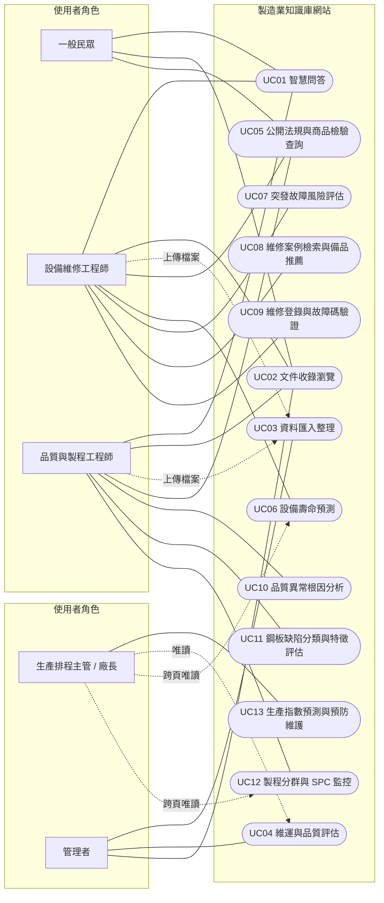

# 製造業知識庫網站 - 需求分析 (RA) 與選單設計規格書 (Step 02・v2 統一版)

> **v2 修訂重點**：13 頁統一編號（頁碼＝選單編號 M-01–M-13＝Use Case UC01–UC13）；保留原 US-01–US-15，新增共同網頁的 **US-16–US-19**；新增 **管理者** 角色；各頁 Skill 改為合理對應（見 `KnowledgeStep03.md` 追溯表）。
>
> 驗收條件中的數字（如 `0.89`、`320.5`）為**設計示意值**，Skill 以真實資料執行後須改成實際結果。

## 一、 需求分析清單 (故事表) (User Stories)

| 編號 | 角色 | 故事 (要做什麼事) | 畫面 | 驗收條件 (做了什麼 → 看到什麼) |
| :--- | :--- | :--- | :--- | :--- |
| **US-01** | 一般民眾 | 查詢市售電動工具檢驗規定與 CNS 安全標準 | 05. 公開法規與商品檢驗查詢頁 | **動作**：輸入「電動工具檢驗」並查詢。 **畫面**：Top 3 法規卡片與 CNS 標準號列。 **數字/JSON**：`CNS-1234` 條文標題、`similarity_score: 0.89`；最高分低於門檻（預設 0.10，設定檔參數）時顯示「查不到相關法規資料」。 |
| **US-02** | 一般民眾 | 查詢操作危險性機械之法規資格與檢驗摘要 | 05. 公開法規與商品檢驗查詢頁 | **動作**：選「衝壓剪切機械」並查詢人員資格。 **畫面**：職安法規條文與操作資格摘要卡。 **數字/JSON**：Jaccard 相似度分數（門檻預設 0.20）、缺少的資格項目、`status: "success"`。 |
| **US-03** | 設備維修工程師 | 輸入感測器參數，預測設備剩餘使用壽命 (RUL) | 06. 設備壽命預測頁 | **動作**：輸入運轉時數 1500h、振動 2.8mm/s、溫度 75°C、負載率 85%。 **畫面**：健康度衰退曲線與 RUL 儀表板。 **數字/JSON**：`predicted_rul_hours: 320.5`、OLS 係數、**訓練與測試分開列** MAE / RMSE；標「僅供參考」。 |
| **US-04** | 設備維修工程師 | 評估設備突發故障機率與勝算比 | 07. 設備突發故障風險評估頁 | **動作**：輸入距上次維修 45 天、近 90 天警報 12 次、壓力 1.8MPa。 **畫面**：Sigmoid 機率分布圖。 **數字/JSON**：`failure_probability: 0.84`、`odds_ratio: 5.25`、紅黃綠燈號。 |
| **US-05** | 設備維修工程師 | 找出讓總成本最低的停機預警門檻 | 07. 設備突發故障風險評估頁 | **動作**：設定停機損失與誤報派工成本並執行門檻掃描。 **畫面**：總成本曲線，最低點高亮。 **數字/JSON**：`optimal_threshold: 0.65`、`total_cost_min: 12000`、該門檻下的 FP / FN 筆數。 |
| **US-06** | 設備維修工程師 | 輸入故障碼檢索 Top 3 相似歷史維修案例 | 08. 歷史維修案例檢索與備品推薦頁 | **動作**：選故障碼「E-8021」並輸入特徵。 **畫面**：Top 3 工單卡片與排除步驟對比表。 **數字/JSON**：`case_id: "MA-2024-089"`、`similarity: 0.94`（由歐氏距離換算）。 |
| **US-07** | 設備維修工程師 | 依相似案例推薦故障處理備品 | 08. 歷史維修案例檢索與備品推薦頁 | **動作**：點選相似案例，執行備品推薦。 **畫面**：推薦備品清單、領用頻率與庫存標籤。 **數字/JSON**：`part_id: "SP-8821"`、`score: 0.88`。 |
| **US-08** | 設備維修工程師 | 登錄維修時間軸並即時驗證故障碼與數值是否合理 | 09. 維修案例登錄與故障碼驗證頁 | **動作**：填寫維修紀錄，輸入電流與壓力。 **畫面**：欄位檢查結果與合規綠燈 / 紅色警告。 **數字/JSON**：`validation_result: 0`、`status: "COMPLIANT"`、更新後權重 `w1, w2, bias`；欄位格式錯誤時不送感知器並列出錯誤欄位。 |
| **US-09** | 品質與製程工程師 | 監控良率並追查品質異常根本原因 | 10. 品質異常根本原因分析頁 | **動作**：選批次、設定樹數量，執行分析。 **畫面**：良率趨勢折線圖與特徵重要度橫條圖。 **數字/JSON**：`temp: 0.42`、`cooling: 0.31`、`ensemble_prediction: 1`；標「只代表相關，不代表因果」。 |
| **US-10** | 品質與製程工程師 | 依幾何與光學特徵分類鋼板表面缺陷 | 11. 鋼板表面缺陷分類與特徵評估頁 | **動作**：輸入面積 150、長寬比 4.2、灰階對比。 **畫面**：樹狀節點圖與混淆矩陣。 **數字/JSON**：`defect_class: "Scratch"`、混淆矩陣 `[[45, 2], [1, 48]]`。 |
| **US-11** | 品質與製程工程師 | 剪枝並導出看得懂的判斷規則 | 11. 鋼板表面缺陷分類與特徵評估頁 | **動作**：調整剪枝係數 α 並執行。 **畫面**：白盒規則卡片與剪枝前後準確率對比。 **數字/JSON**：`rule_path: "IF area > 120 AND aspect_ratio > 3.5 THEN Scratch"`。 |
| **US-12** | 品質與製程工程師 | 將製程參數分群，並決定分幾群 | 12. 製程參數分群與 SPC 管制監控頁 | **動作**：選參數 z 分數、執行手肘法與分群。 **畫面**：SSE 手肘圖與分群散佈圖。 **數字/JSON**：`optimal_k: 3`、`sse: 42.5`、`cluster_centers`。 |
| **US-13** | 品質與製程工程師 | 用 ±3σ 管制圖找出製程異常點 | 12. 製程參數分群與 SPC 管制監控頁 | **動作**：開啟 SPC 管制線。 **畫面**：含 UCL / LCL 的管制圖，異常點標紅。 **數字/JSON**：`spc_limits: {"ucl": 3.0, "lcl": -3.0}`、`outliers_count: 2`。 |
| **US-14** | 生產排程主管 / 廠長 | 預測未來工業生產指數走勢 | 13. 智慧生產指數預測與管理頁 | **動作**：載入歷史月度 IPI 與總體變數。 **畫面**：未來 1–3 季預估折線圖與損失收斂圖。 **數字/JSON**：`ipi_forecast_next_quarter: [108.5, 109.2, 110.1]`、`training_loss_final: 0.012`、測試誤差與「延續上月」基準比較；標「僅供參考」。 |
| **US-15** | 生產排程主管 / 廠長 | 依設備風險階層規劃預防維護時程 | 13. 智慧生產指數預測與管理頁 | **動作**：選設備風險指標、設定分群距離門檻。 **畫面**：Dendrogram 與預防維護甘特圖。 **數字/JSON**：3 個風險階層、各階層設備清單與建議保養週次。 |
| **US-16** | 一般民眾、各工程師 | 輸入問題，看到附來源的答案，這樣我知道答案可不可信 | 01. 製造知識庫檢索與智慧問答頁 | **動作**：問「衝壓機馬達過熱怎麼處理？」。 **畫面**：解答卡片與至少 1 張來源卡（文件名稱、連結）。 **數字/JSON**：`similarity_score`；問知識庫沒有的問題時（分數低於門檻，預設 0.10）回「查不到相關法規與案例資料」，不硬答；可依範圍（全部 / 公開法規 / 維修案例）篩選。 |
| **US-17** | 一般民眾、各工程師 | 瀏覽收進來的每一份文件和出處，這樣我能回原始網頁核對 | 02. 製造規範與技術文件收錄頁 | **動作**：依類別與日期篩選，點一份文件。 **畫面**：文件清單表格與右側切片預覽抽屜。 **數字/JSON**：`source_name`、`updated_at`、`license_type`、`content_preview`、`source_url`；一般民眾只看得到公開文件。 |
| **US-18** | 管理者 | 有新資料時按一次「開始匯入」，看到每一步的進度和失敗原因 | 03. 工廠圖資與維修履歷匯入整理頁 | **動作**：選檔案、勾清理規則，按「開始匯入與整理」。 **畫面**：五步進度（讀取→清理→去重→切片→重算模型結果）與統計卡。 **數字/JSON**：`rows_cleaned_count`、`chunks_created_count`、`duplicate_rate_pct`；筆數核對沒過就不寫入，失敗原因存入匯入紀錄。工程師可上傳檔案，但匯入由管理者執行。 |
| **US-19** | 管理者 | 知道站上資料新不新、檢索和回答品質好不好 | 04. 製造知識庫維運與回答品質評估頁 | **動作**：設定基準日與落後門檻，按「立即檢查」；按「執行命中率測試」。 **畫面**：各資料集最新日期與落後提醒（超過門檻標黃）、命中率指標、錯誤案例表。 **數字/JSON**：`hit_rate_top3_pct`、`mrr`（20 題標準問答）、`error_cases_list`；頁面寫出限制。廠長可唯讀查看。 |

---

## 二、 選單設計表 (Menu Design Table)

| 選單編號 | 功能選單名稱 (畫面) | 對應故事 | 使用者可以做什麼 | 頁面顯示的數據 | 使用者操作流程 |
| :--- | :--- | :--- | :--- | :--- | :--- |
| **M-01** | 01. 製造知識庫檢索與智慧問答頁 | US-16 | 輸入自然語言問題，查看解答、引用來源與原文連結；無相關資料就明說「查不到」。 | `answer_text`、`source_title` / `source_url`、`similarity_score`（skill_01）、查無資料提示 | 輸入問題 → 選範圍 → 按「一鍵智慧問答」→ 看解答卡、來源與分數；查不到時看到提示。 |
| **M-02** | 02. 製造規範與技術文件收錄頁 | US-17 | 列出已收錄文件（來源、更新日期、授權），點選預覽切片與原始出處。 | `source_name`、`updated_at`、`license_type`、`content_preview`、`source_url`（skill_26） | 選類別與日期 → 瀏覽表格 → 點一列 → 側邊抽屜顯示切片與出處。 |
| **M-03** | 03. 工廠圖資與維修履歷匯入整理頁 | US-18 | 上傳維修履歷、設備手冊、製程數據 (PDF/CSV/MD)，看匯入進度、清理結果、切片與去重率。 | `import_progress_pct`、`rows_cleaned_count`、`chunks_created_count`、`duplicate_rate_pct`、匯入紀錄（skill_27、skill_03） | 拖曳檔案 → 勾清理規則 → 按「開始匯入與整理」→ 看五步進度與統計，或看失敗原因。 |
| **M-04** | 04. 製造知識庫維運與回答品質評估頁 | US-19 | 監控資料新鮮度與過期提醒、測試 Top-3 命中率與 MRR、查看錯誤案例。 | `data_freshness_status`、`expiration_warning`、`hit_rate_top3_pct`、`mrr`、`error_cases_list`（skill_28、skill_29） | 設定基準日 → 按「立即檢查」→ 看落後提醒 → 按「執行命中率測試」→ 看指標與錯誤案例。 |
| **M-05** | 05. 公開法規與商品檢驗查詢頁 | US-01、US-02 | 查詢電動工具檢驗規定、CNS 標準與危險性機械操作資格。 | `regulation_id`、`title`、`summary`、`similarity_score`（skill_01 餘弦 / skill_02 Jaccard） | 輸入關鍵字或選機械類別 → 勾法規類型 → 按「查詢法規」→ 看 Top K 卡片與分數。 |
| **M-06** | 06. 設備壽命預測頁 | US-03 | 輸入感測器參數預測 RUL，並看各參數影響。 | `predicted_rul_hours`、`regression_coefficients`、`mae` / `rmse`（skill_03 → 04 → 05） | 選設備 → 調滑桿 → 按「執行 RUL 預測」→ 看衰退曲線與儀表板。 |
| **M-07** | 07. 設備突發故障風險評估頁 | US-04、US-05 | 評估故障機率，設定成本，得到燈號與最佳預警門檻。 | `failure_probability`、`odds_ratio`、`risk_level`、`optimal_threshold`、`total_cost_min`（skill_06 → 07 → 08） | 輸入三項指標 → 設成本 → 按「計算故障風險與最佳門檻」→ 看燈號與成本曲線。 |
| **M-08** | 08. 歷史維修案例檢索與備品推薦頁 | US-06、US-07 | 依故障碼找 Top 3 相似案例並推薦備品。 | `top3_similar_cases`、`recommended_parts`（skill_10 → 09 → 11） | 選故障碼 → 按「檢索相似案例與備品」→ 看工單對比表 → 看備品清單與庫存標籤。 |
| **M-09** | 09. 維修案例登錄與故障碼驗證頁 | US-08 | 填寫維修時間軸與即時數值，先做欄位防呆再做感知器合規判斷。 | `is_valid`、`validation_result`、`status`、`updated_weights`（skill_12 → 13） | 填紀錄 → 輸入電流與壓力 → 按「即時驗證並儲存案例」→ 看綠燈或警告。 |
| **M-10** | 10. 品質異常根本原因分析頁 | US-09 | 判斷批次是否異常，排序影響品質的製程參數並產生報告。 | `yield_rate_prediction`、`ensemble_prediction`、`feature_importance`、根因報告（skill_14 → 15 → 16） | 選批次與樹數 → 按「執行根因分析」→ 看良率趨勢與重要度橫條圖。 |
| **M-11** | 11. 鋼板表面缺陷分類與特徵評估頁 | US-10、US-11 | 分類缺陷、評估特徵影響力、剪枝並導出 IF-THEN 規則。 | `defect_class`、`feature_importance`、`rule_path`、`confusion_matrix`（skill_17 → 18 → 19） | 輸入特徵 → 調 α → 按「分類缺陷與導出規則」→ 看樹狀圖、混淆矩陣與規則卡。 |
| **M-12** | 12. 製程參數分群與 SPC 管制監控頁 | US-12、US-13 | K-Means 分群、手肘法定群數、±3σ 管制圖監控異常。 | `optimal_k`、`cluster_centers`、`sse`、`spc_limits`、`outliers_count`（skill_21 → 20 → 22） | 選參數與 K → 按「執行手肘法與聚類」→ 看手肘圖與散佈圖 → 開 SPC 開關看異常點。 |
| **M-13** | 13. 智慧生產指數預測與管理頁 | US-14、US-15 | 預測 IPI 走勢，並以階層分群規劃預防維護。 | `ipi_forecast_next_quarter`、`training_loss_final`、`dendrogram_clusters`、`preventive_schedule`（skill_23；skill_24 → 25） | 載入數據 → 設分群門檻 → 按「生成指數預測與維護排程」→ 看走勢圖、樹狀圖與甘特圖。 |

---

## 三、 角色表 (Role Specification Table)

| 角色 | 角色的解釋 | 能做什麼 | 不能做什麼 |
| :--- | :--- | :--- | :--- |
| **一般民眾** | 外部公開使用者、電動工具購買者、工安與檢驗法規查詢者；不登入。 | 智慧問答（僅公開法規範圍）、瀏覽公開文件、查詢商品檢驗與 CNS 標準、危險性機械操作資格（01、02、05）。 | 不能看廠內設備、維修、品質數據與 SPC；不能上傳、匯入、修改、刪除任何資料。 |
| **設備維修工程師** | 第一線設備維修、故障診斷、維修履歷登錄與備品領用人員。 | 01、02、05 全部功能；RUL 預測、故障風險與預警門檻、相似案例與備品推薦、維修登錄與即時驗證（06–09）；可在 03 上傳維修履歷檔案。 | 不能修改品質管制界限與製程參數；不能看 IPI 與全廠排程；不能執行匯入、重算模型或改系統設定。 |
| **品質與製程工程師** | 監控良率、鋼板缺陷分析、SPC 異常追蹤與製程參數最佳化的技術人員。 | 01、02、05 全部功能；根因分析、缺陷分類與白盒規則、製程分群與 SPC（10–12）；可在 03 上傳製程數據檔案。 | 不能修改設備工程師登錄的維修紀錄與備品庫存；不能看全廠 IPI 與排程；不能執行匯入或管理帳號。 |
| **生產排程主管 / 廠長** | 高階生產排程、全廠預防維護規劃、生產指數預測與營運決策者。 | 13 全部功能；跨頁唯讀調閱 06–12；唯讀查看 04 的資料新鮮度與品質指標。 | 不能覆寫原始維修與品質紀錄（保留稽核軌跡）；不能執行匯入、改模型或改程式。 |
| **管理者** | 維護知識庫的人（知識庫管理者 / 系統維運人員）。 | 執行資料匯入整理與重算模型結果檔（03）、檢查資料新鮮度與重跑檢索評估（04）、管理文件收錄（02）；也能使用其他角色的所有功能。 | 不能在畫面上直接改動模型輸出的數字（只能改資料後重算）；API 金鑰不得寫進程式、報告與截圖。 |

---

## 四、 Use Case 圖：誰用這個知識庫、做什麼

每個 Use Case 對到 1 個網頁（UC 編號＝頁碼）。

| 說明 | 內容 |
| :--- | :--- |
| ① | 一般民眾只用 UC01、UC02（公開文件）、UC05。 |
| ② | 兩種工程師共用 UC01、UC02、UC05，並可在 UC03 上傳檔案；各自負責 UC06–09、UC10–12。 |
| ③ | 廠長負責 UC13，可唯讀 UC04 與 UC06–UC12（圖中只畫代表性的 UC06、UC12）。 |
| ④ | 管理者負責 UC03、UC04、UC02 的收錄管理，也能使用全部 Use Case（圖中省略其餘連線）。 |

---

## 五、 各選單網頁線框與區塊清單 (Wireframe & Blocks)

> 共用版型（13 頁一致）：頂部 Header（頁名、頁碼、URL、故事編號、角色徽章）、左側 13 頁導覽選單、資料來源 / 授權 / 取得日期列、載入遮罩 Overlay、「這個結果怎麼算的」三色標籤面板（🔵 Skill、🟣 課堂演算法、⚫ 套件）。頁名與欄位不放演算法名稱，演算法只出現在三色標籤。預測類頁面（06、07、13）必須標「僅供參考」。

### 頁面 01：製造知識庫檢索與智慧問答頁
* **網址**：`/knowledge/chat`　**API**：`POST /api/search`　**故事**：US-16
* **主要角色**：一般民眾、設備維修工程師、品質與製程工程師
* **畫面區塊**：
  1. **提問區**：問題輸入框（水印「例如：衝壓機運轉溫度過高如何處理？」）、範圍下拉（全部 / 公開法規 / 維修案例）、「一鍵智慧問答」、「清除重新輸入」。
  2. **解答卡片** `[#SK-01]`：`answer_text`、來源卡（`source_title`、`source_url`）、`similarity_score` 徽章。
  3. **查無資料提示**：最高分低於門檻時顯示「查不到相關法規與案例資料」。
  4. **熱門問題側欄**：近期查詢與常見 FAQ。
* **計算流程（5 步 steps）**：
  1. 依範圍路由到對應 AnythingLLM 工作區。
  2. `skill_01`：查詢字串分詞並轉 TF-IDF 向量（`math`、`collections`）。
  3. `skill_01`：與知識庫切片算**餘弦相似度**，以 **KNN** 取 Top-K。
  4. Guardrail：最高分 < 門檻（預設 0.10）→ 回查無資料，不呼叫 LLM。
  5. 通過時呼叫 AnythingLLM Developer API（`mode: "query"`）產生回答，合併來源卡輸出。

### 頁面 02：製造規範與技術文件收錄頁
* **網址**：`/knowledge/documents`　**API**：`POST /api/documents`　**故事**：US-17
* **主要角色**：一般民眾（公開文件）、各工程師、管理者
* **畫面區塊**：
  1. **篩選工具列**：類別多選（CNS 標準 / 職安法規 / 設備維修手冊 / 製程品質規範）、日期區間、關鍵字、「套用篩選」、「匯出文件清單」。
  2. **文件表格**：文件編號、`source_name`、類別、`updated_at`、`license_type`、操作（檢視 / 原文連結）。
  3. **切片預覽抽屜** `[#SK-26]`：標題、出處 URL、`content_preview`、字數與收錄時間。
* **計算流程**：`skill_26_document_catalog_query` 以 `sqlite3` 依角色、類別、日期、關鍵字過濾文件元資料（匯入時由 skill_27 寫入）。

### 頁面 03：工廠圖資與維修履歷匯入整理頁
* **網址**：`/knowledge/import`　**API**：`POST /api/import`　**故事**：US-18
* **主要角色**：管理者（工程師可上傳）
* **畫面區塊**：
  1. **檔案拖曳區**：支援 `.pdf`、`.csv`、`.md`；類型標籤（維修履歷 / 感測器圖資 / 設備規格書 / 製程數據）。
  2. **清理規則**：去除非法字元、標準化時間格式、去除重複段落、滑動視窗切片；「開始匯入與整理」（僅管理者可按）。
  3. **五步進度儀表板** `[#SK-27, #SK-03]`：讀取 → 清理 → 去重 → 切片 → 重算模型結果檔；統計卡 `rows_cleaned_count`、`chunks_created_count`、`duplicate_rate_pct`。
  4. **匯入紀錄表**：每步狀態、讀進與存入筆數、失敗原因。
* **計算流程**：`skill_27_kb_import_pipeline` 用 `re` 清洗、`hashlib` SHA-256 去重、固定長度滑動視窗切片並寫入文件索引；感測器 CSV 另交 `skill_03` 標準化；最後重跑模型類 Skill，結果存成 JSON 檔（網頁只讀結果，不在使用者按下時重算）。

### 頁面 04：製造知識庫維運與回答品質評估頁
* **網址**：`/knowledge/ops-eval`　**API**：`POST /api/ops/freshness`、`POST /api/ops/eval`　**故事**：US-19
* **主要角色**：管理者（廠長唯讀）
* **畫面區塊**：
  1. **KPI 卡** `[#SK-28]`：資料新鮮度（正常 / 需更新）、落後超過門檻的資料集數、系統版本。
  2. **各資料集狀態表**：最新資料日期、落後月數（超過門檻標黃）、最近一次匯入結果。
  3. **品質指標區** `[#SK-29]`：Top-3 命中率、MRR、回答有無引用正確來源。
  4. **控制列**：基準日、落後門檻（預設 3 個月）、「立即檢查」、「執行命中率測試」。
  5. **錯誤案例表**：題號、提問、預期來源、實際檢索結果、錯誤類別（查無資料 / 偏離）。
  6. **限制說明**。
* **計算流程**：`skill_28` 算落後月數與時間衰減權重 $W(t)=e^{-\lambda \Delta t}$；`skill_29` 以 20 題標準問答算 Hit@3 與 $\text{MRR} = \frac{1}{|Q|}\sum \frac{1}{\text{rank}_i}$（`statistics`、`math`、`datetime`）。

### 頁面 05：公開法規與商品檢驗查詢頁
* **網址**：`/regulations/search`　**API**：`POST /api/regulation-search`、`POST /api/qualification-match`　**故事**：US-01、US-02
* **主要角色**：一般民眾
* **畫面區塊**：
  1. **搜尋面板**：貨品號列 / 關鍵字、機械類別下拉（衝壓剪切機械 / 電動工具 / 升降機具）、法規類型勾選（CNS / 職安法規）、「查詢法規與檢驗資格」。
  2. **結果列表** `[#SK-01, #SK-02]`：條文卡（`regulation_id`、`title`、`summary`）、分數徽章、展開完整條文。
* **計算流程**：關鍵字查詢走 `skill_01`（TF-IDF + 餘弦 + KNN）；機械資格查詢走 `skill_02`（Jaccard $J(A,B)=\frac{|A\cap B|}{|A\cup B|}$ + KNN），各自套用門檻防呆。

### 頁面 06：設備壽命預測頁
* **網址**：`/equipment/rul-prediction`　**API**：`POST /api/rul-prediction`　**故事**：US-03
* **畫面區塊**：
  1. **參數輸入**：設備 ID、運轉時數、振動、溫度、負載率滑桿、「執行 RUL 壽命預測」。
  2. **結果卡** `[#SK-03, #SK-04, #SK-05]`：`predicted_rul_hours`、係數表、MAE / RMSE（訓練與測試分開）、「僅供參考」。
  3. **衰退趨勢圖**：歷史實線、預測虛線。
* **計算流程**：`skill_03` Z-Score → `skill_04` OLS $\boldsymbol{\beta}=(\mathbf{X}^T\mathbf{X})^{-1}\mathbf{X}^T\mathbf{y}$ → `skill_05` 係數貢獻拆解。

### 頁面 07：設備突發故障風險評估頁
* **網址**：`/equipment/failure-risk`　**API**：`POST /api/failure-risk`　**故事**：US-04、US-05
* **畫面區塊**：
  1. **輸入與成本設定**：`recency_days`、`alarms_90d`、`pressure`；$C_{\text{down}}$、$C_{\text{inspect}}$；「評估故障風險與計算最佳門檻」。
  2. **結果卡** `[#SK-06, #SK-07, #SK-08]`：燈號、`failure_probability`、`odds_ratio`、`optimal_threshold`、`total_cost_min`。
  3. **成本曲線圖**。
* **計算流程**：`skill_06` $P=\frac{1}{1+e^{-(\mathbf{w}^T\mathbf{x}+b)}}$ → `skill_07` 勝算比與燈號 → `skill_08` 掃描 $\theta$ 極小化 $C_{\text{down}}\cdot FN(\theta)+C_{\text{inspect}}\cdot FP(\theta)$。

### 頁面 08：歷史維修案例檢索與備品推薦頁
* **網址**：`/equipment/case-retrieval`　**API**：`POST /api/case-retrieval`　**故事**：US-06、US-07
* **畫面區塊**：
  1. **搜尋面板**：故障碼下拉、特徵輸入與權重滑桿、「檢索相似案例與推薦備品」。
  2. **Top 3 案例卡** `[#SK-10, #SK-09]`：`case_id`、故障描述、排除步驟、`similarity`。
  3. **備品表** `[#SK-11]`：`part_id`、名稱、`score`、庫存警示。
* **計算流程**：`skill_10` 故障碼轉標準化加權特徵 → `skill_09` 歐氏距離 KNN（K=3）→ `skill_11` 備品共現矩陣物品相似度加權推薦。

### 頁面 09：維修案例登錄與故障碼驗證頁
* **網址**：`/equipment/repair-log`　**API**：`POST /api/repair-log/validate`　**故事**：US-08
* **畫面區塊**：
  1. **時間軸表單**：設備 ID、日期時間、故障碼、處置說明。
  2. **即時數值**：`current`、`pressure`、「即時驗證並儲存案例」。
  3. **驗證看板** `[#SK-12, #SK-13]`：欄位檢查結果、合規燈號、`validation_result`、權重更新日誌。
* **計算流程**：`skill_12` 正則與臨界值檢查（不通過就停止）→ `skill_13` 感知器 $f(\mathbf{x})=\text{step}(\mathbf{w}^T\mathbf{x}+b)$，判錯時 $\mathbf{w}\leftarrow\mathbf{w}+\eta(y-\hat{y})\mathbf{x}$。

### 頁面 10：品質異常根本原因分析頁
* **網址**：`/quality/root-cause`　**API**：`POST /api/root-cause`　**故事**：US-09
* **畫面區塊**：
  1. **設定區**：`batch_id`、樹數量滑桿（預設 100）、「執行根本原因分析」。
  2. **良率卡** `[#SK-14]`：`yield_rate_prediction`、`ensemble_prediction`。
  3. **重要度橫條圖** `[#SK-15]` 與 **根因報告卡** `[#SK-16]`。
* **計算流程**：`skill_14` Bootstrap 多樹投票 → `skill_15` 吉尼 $I_G=1-\sum p_i^2$ 平均下降量排序 → `skill_16` 整合報告。

### 頁面 11：鋼板表面缺陷分類與特徵評估頁
* **網址**：`/quality/steel-defects`　**API**：`POST /api/steel-defects`　**故事**：US-10、US-11
* **畫面區塊**：
  1. **特徵輸入**：`area`、`aspect_ratio`、`contrast`、α 滑桿、「執行缺陷分類與白盒規則推理」。
  2. **結果區** `[#SK-17, #SK-18, #SK-19]`：`defect_class`、特徵影響力、規則卡、混淆矩陣、剪枝前後準確率。
* **計算流程**：`skill_17` CART 多類別劃分 → `skill_18` 特徵吉尼重要度 → `skill_19` 代價複雜度剪枝 $R_\alpha(T)=R(T)+\alpha|T|$ 並導出 IF-THEN 規則。

### 頁面 12：製程參數分群與 SPC 管制監控頁
* **網址**：`/quality/spc-clustering`　**API**：`POST /api/spc-clustering`　**故事**：US-12、US-13
* **畫面區塊**：
  1. **控制列**：z 分數選擇、K 滑桿、SPC 開關、「執行手肘法分群與 SPC 監控」。
  2. **分析區** `[#SK-21, #SK-20, #SK-22]`：手肘圖與 `optimal_k`、群中心表、`spc_limits`、`outliers_count`。
  3. **視覺化**：分群散佈圖、管制圖（異常點標紅）。
* **計算流程**：`skill_21` 算 k=1–8 的 SSE 找轉折 → `skill_20` 以選定 K 迭代更新 $\boldsymbol{\mu}_k$ → `skill_22` $\text{UCL/LCL}=\mu\pm3\sigma$。

### 頁面 13：智慧生產指數預測與管理頁
* **網址**：`/production/index-forecast`　**API**：`POST /api/index-forecast`　**故事**：US-14、US-15
* **畫面區塊**：
  1. **變數選擇**：IPI、出口訂單、稼動率、季節變數；分群距離門檻；「生成指數預測與預防維護甘特圖」。
  2. **預測區** `[#SK-23]`：未來三季預估、訓練損失曲線、測試誤差與基準比較、「僅供參考」。
  3. **風險階層區** `[#SK-24, #SK-25]`：Dendrogram、各階層設備、預防維護甘特圖。
* **計算流程**：`skill_23` MLP 前向傳播與反向傳播 $\Delta w_{ij}=-\eta\frac{\partial E}{\partial w_{ij}}$（真實訓練）；`skill_24` 凝聚法建樹 → `skill_25` 依門檻切樹並輸出排程與報告。
