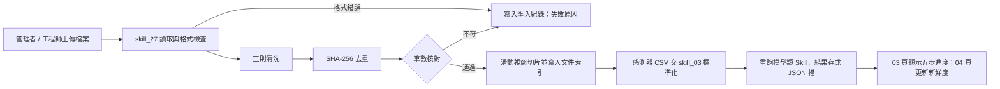

# 製造業知識庫網站 - 系統分析 (SA) 與需求追溯規格書 (Step 03・v2 統一版)

> **v2 修訂重點**：13 頁 × 19 個故事 × 29 個 Skill 全部對齊；移除不合理對應（例如匯入頁掛成本門檻、維運頁掛感知器）；共同網頁改用專屬 Skill 26–29；套件限 Python 標準函式庫（scikit-learn、numpy 為 BSD 授權，不符「MIT 授權」規定，已移除）；新增驗證計畫與第二條業務流程。

## 一、 系統分析 (SA) - 操作與數據對照表

| 選單頁 | 使用者操作 | 依序經過的 Skill | 演算法 | 處理機制（套件） | 顯示的數據 |
| :--- | :--- | :--- | :--- | :--- | :--- |
| **01. 製造知識庫檢索與智慧問答頁** (`/knowledge/chat`) | 輸入問題 → 選範圍 → 按「一鍵智慧問答」 | `skill_01_tool_regulation_search` → AnythingLLM Developer API | KNN + 餘弦相似度 | TF-IDF 向量化、$\cos\theta=\frac{\mathbf{A}\cdot\mathbf{B}}{\|\mathbf{A}\|\|\mathbf{B}\|}$、門檻防呆（預設 0.10）、`mode: query` 只依文件回答（`math`、`collections`、`requests`） | `answer_text`、來源卡、`similarity_score`、查無資料提示 |
| **02. 製造規範與技術文件收錄頁** (`/knowledge/documents`) | 選類別與日期 → 點一份文件 | `skill_26_document_catalog_query` | —（非課堂演算法） | 依角色、類別、日期、關鍵字 SQL 過濾（`sqlite3`） | `source_name`、`updated_at`、`license_type`、`content_preview`、`source_url` |
| **03. 工廠圖資與維修履歷匯入整理頁** (`/knowledge/import`) | 上傳檔案 → 勾清理規則 → 按「開始匯入與整理」 | `skill_27_kb_import_pipeline` →（感測器 CSV）`skill_03_sensor_data_preprocessing` → 重跑模型類 Skill 存結果檔 | —（非課堂演算法） | 正則清洗（`re`）、SHA-256 雜湊去重（`hashlib`）、滑動視窗切片、筆數核對 | 五步進度、`rows_cleaned_count`、`chunks_created_count`、`duplicate_rate_pct`、匯入紀錄與失敗原因 |
| **04. 製造知識庫維運與回答品質評估頁** (`/knowledge/ops-eval`) | 設基準日 → 按「立即檢查」→ 按「執行命中率測試」 | `skill_28_data_freshness_check`、`skill_29_retrieval_quality_eval` | —（非課堂演算法） | 落後月數、$W(t)=e^{-\lambda\Delta t}$、Hit@3、$\text{MRR}=\frac{1}{|Q|}\sum\frac{1}{\text{rank}_i}$（`datetime`、`statistics`、`math`） | 新鮮度燈號、落後提醒、`hit_rate_top3_pct`、`mrr`、錯誤案例表 |
| **05. 公開法規與商品檢驗查詢頁** (`/regulations/search`) | 輸入關鍵字或選機械類別 → 按「查詢法規」 | `skill_01_tool_regulation_search`（關鍵字）／`skill_02_machine_qualification_match`（機械資格） | KNN + 餘弦 / Jaccard | TF-IDF 餘弦、$J(A,B)=\frac{|A\cap B|}{|A\cup B|}$、門檻防呆（0.10 / 0.20）（`math`、`collections`） | `regulation_id`、`title`、`summary`、`similarity_score` |
| **06. 設備壽命預測頁** (`/equipment/rul-prediction`) | 選設備 → 調滑桿 → 按「執行 RUL 預測」 | `skill_03` → `skill_04` → `skill_05` | 多元線性迴歸 (OLS) | $z=\frac{x-\mu}{\sigma}$、$\boldsymbol{\beta}=(\mathbf{X}^T\mathbf{X})^{-1}\mathbf{X}^T\mathbf{y}$（純 Python 高斯消去）、係數貢獻拆解 | `predicted_rul_hours`、衰退曲線、係數、訓練／測試 MAE、RMSE |
| **07. 設備突發故障風險評估頁** (`/equipment/failure-risk`) | 輸入三項指標 → 設成本 → 按「計算故障風險與最佳門檻」 | `skill_06` → `skill_07` → `skill_08` | 邏輯迴歸 + 門檻成本取捨 | Sigmoid、勝算比 $e^{\mathbf{w}^T\mathbf{x}}$、掃描 $\theta$ 極小化 $C_{\text{down}}FN+C_{\text{inspect}}FP$（`math`） | `failure_probability`、`odds_ratio`、`risk_level`、`optimal_threshold`、`total_cost_min` |
| **08. 歷史維修案例檢索與備品推薦頁** (`/equipment/case-retrieval`) | 選故障碼 → 按「檢索相似案例與備品」 | `skill_10` → `skill_09` → `skill_11` | KNN（歐氏）+ 物品協同過濾 | 故障碼特徵加權、$d=\sqrt{\sum(x_i-y_i)^2}$ 取 Top 3、備品共現矩陣餘弦相似度（`math`） | `top3_similar_cases`、排除步驟對比、`recommended_parts` |
| **09. 維修案例登錄與故障碼驗證頁** (`/equipment/repair-log`) | 填紀錄 → 輸入電流與壓力 → 按「即時驗證並儲存案例」 | `skill_12` → `skill_13` | 單層感知器 | 欄位格式與臨界值檢查（`re`）、$\text{step}(\mathbf{w}^T\mathbf{x}+b)$、$\mathbf{w}\leftarrow\mathbf{w}+\eta(y-\hat{y})\mathbf{x}$ | `is_valid`、`validation_result`、`status`、`updated_weights` |
| **10. 品質異常根本原因分析頁** (`/quality/root-cause`) | 選批次與樹數 → 按「執行根因分析」 | `skill_14` → `skill_15` → `skill_16` | 隨機森林 | Bootstrap 多數決、吉尼 $1-\sum p_i^2$ 平均下降量（`random`、`math`） | `yield_rate_prediction`、`ensemble_prediction`、`feature_importance`、根因報告 |
| **11. 鋼板表面缺陷分類與特徵評估頁** (`/quality/steel-defects`) | 輸入特徵 → 調 α → 按「執行分類與推理」 | `skill_17` → `skill_18` → `skill_19` | CART 決策樹 + 剪枝 | 吉尼劃分、特徵重要度、$R_\alpha(T)=R(T)+\alpha|T|$、路徑轉 IF-THEN（純 Python） | `defect_class`、特徵影響力、`rule_path`、`confusion_matrix` |
| **12. 製程參數分群與 SPC 管制監控頁** (`/quality/spc-clustering`) | 選參數與 K → 按「執行手肘法與聚類」→ 開 SPC 開關 | `skill_21` → `skill_20` → `skill_22` | K 平均 + 手肘法 + SPC | k=1–8 SSE、質心迭代、$\mu\pm3\sigma$（`statistics`、`math`） | `optimal_k`、`cluster_centers`、`sse`、`spc_limits`、`outliers_count` |
| **13. 智慧生產指數預測與管理頁** (`/production/index-forecast`) | 選指標 → 設分群門檻 → 按「生成預測與維護排程」 | `skill_23`；`skill_24` → `skill_25` | 多層類神經網路 + 凝聚階層式分群 | 前向傳播、鏈鎖律反向傳播（真實訓練、時間切分）、距離矩陣凝聚建樹與切割（`math`、`random`） | `ipi_forecast_next_quarter`、`training_loss_final`、`dendrogram_clusters`、`preventive_schedule` |

---

## 二、 需求追溯表（故事 → 畫面 → 演算法 → Skill）

任何一格空白就是設計漏洞：故事找不到 Skill 就做不出來；Skill 找不到故事就是多做的。v2 版 29 個 Skill 都至少對到一個故事。

| 故事 | 畫面 | 演算法 / 核心機制 | Skill |
| :--- | :--- | :--- | :--- |
| **US-01** | 05 | KNN + 餘弦相似度 | `skill_01_tool_regulation_search` |
| **US-02** | 05 | KNN + Jaccard 相似度 | `skill_02_machine_qualification_match` |
| **US-03** | 06 | 多元線性迴歸 (OLS) | `skill_03_sensor_data_preprocessing`、`skill_04_equipment_rul_prediction`、`skill_05_degradation_feature_attribution` |
| **US-04** | 07 | 邏輯迴歸 + 勝算比 | `skill_06_failure_probability_calc`、`skill_07_risk_level_classification` |
| **US-05** | 07 | 門檻成本取捨 | `skill_08_cost_sensitive_threshold_tuning` |
| **US-06** | 08 | KNN（歐氏距離） | `skill_10_error_code_feature_matching`、`skill_09_similar_repair_case_search` |
| **US-07** | 08 | 物品協同過濾 | `skill_11_spare_parts_recommendation` |
| **US-08** | 09 | 欄位防呆 + 單層感知器 | `skill_12_repair_log_entry_validation`、`skill_13_error_code_perceptron_check` |
| **US-09** | 10 | 隨機森林 + MDI | `skill_14_yield_rate_anomaly_detection`、`skill_15_feature_importance_ranking`、`skill_16_root_cause_attribution_report` |
| **US-10** | 11 | CART 決策樹 | `skill_17_steel_surface_defect_classify`、`skill_18_defect_geometric_feature_eval` |
| **US-11** | 11 | 代價複雜度剪枝 + 規則提取 | `skill_19_decision_tree_rule_extraction` |
| **US-12** | 12 | K 平均 + 手肘法 | `skill_20_process_parameter_kmeans`、`skill_21_elbow_method_optimal_k` |
| **US-13** | 12 | SPC (Mean ± 3σ) | `skill_22_spc_control_limit_monitoring` |
| **US-14** | 13 | 多層類神經網路 | `skill_23_ipi_mlp_forecast` |
| **US-15** | 13 | 凝聚階層式分群 | `skill_24_preventive_maintenance_hierarchy`、`skill_25_factory_risk_dendrogram_eval` |
| **US-16** | 01 | KNN + 餘弦相似度 + AnythingLLM | `skill_01_tool_regulation_search` |
| **US-17** | 02 | SQLite 元資料過濾 | `skill_26_document_catalog_query` |
| **US-18** | 03 | 正則清洗 + 雜湊去重 + 切片（＋重算模型） | `skill_27_kb_import_pipeline`、`skill_03_sensor_data_preprocessing` |
| **US-19** | 04 | 新鮮度 + Hit@3 / MRR | `skill_28_data_freshness_check`、`skill_29_retrieval_quality_eval` |

---

## 三、 第二條業務流程：管理者匯入新資料（US-18）

* 失敗要寫原因；筆數核對沒過不寫入。
* 匯入完才重跑模型，結果存成檔案；網頁只讀結果，不在使用者按下時重算（輕量計算如 05、07、09 的單筆判斷除外）。

---

## 四、 驗證計畫

| 驗什麼 | 怎麼驗 | 通過標準 |
| :--- | :--- | :--- |
| 每個使用者故事 | 照驗收條件在畫面上一條一條操作 | 每一條都看到預期結果 |
| 有課堂工具的演算法 | 用課堂工具對答案（指令見 `9_code_artifact.md`） | 數字和 Skill 輸出一樣；不一樣要說明原因 |
| 沒有課堂工具的機制（成本門檻、SPC、階層分群、Jaccard、餘弦） | 用 3–5 筆小資料手算 | 手算與 Skill 輸出一致 |
| 和 AnythingLLM 的整合 | 聊天視窗用 `@agent` 問測試題；網站同一題再問一次 | 工具有被呼叫，兩邊答案一致 |
| 每條 Skill 鏈 | 照順序呼叫 Skill，檢查每一步輸出是否為下一步輸入 | 頁面最後顯示的數字與單獨執行 Skill 一致 |
| 訓練與測試 | 依時間或批次切分，測試資料不參與訓練 | 準確率／誤差分開列「訓練」與「測試」 |
| 真實訓練（skill_23 等） | 換一份資料重跑、看 loss 是否逐輪下降 | 結果隨資料改變；無寫死的輸出數字 |
| 結果檔 | 打開每個 Skill 的 JSON | 都有結果與 5 步 `steps`；網頁換選項時顯示對應那一筆 |
| 資料新鮮度 | `skill_28` 指定基準日重跑 | 落後超過門檻會提醒 |
| 安全 | 檢查程式、報告、截圖 | 沒有 API 金鑰、個資與帳密 |
